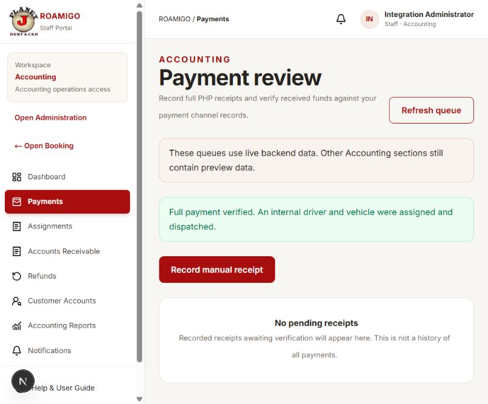

# Live payment review and assignment

## Current screens

- /accounting/payments records manual receipts and lists pending receipt reviews.
- /accounting/assignments lists pending allocation and recovery requests.
- Both pages require authenticated ADMIN or non-driver STAFF access. The server proxy verifies the session on each request; the backend also enforces operator eligibility.
- Other Accounting pages remain preview data. These queues do not provide a complete payment ledger or booking history.

Receipt entry requires a known booking UUID, the exact full quoted PHP amount, a payment method and receipt reference, and an evidence note. No general staff booking search exists in this slice. Entering a receipt does not mark the booking paid.

Approval requires external confirmation of received funds and a decision reason. It can allocate and dispatch an eligible internal pair. A successful payment approval can also leave assignment pending; the response and assignment queue describe that separately. Rejection does not record a refund.

Mutations require a same-origin request, known operation, UUID, allowed fields and explicit confirmation. Tokens stay in the server session cookie. Network errors, invalid result responses and service failures lock the original command. Retry sends that same command using the backend's receipt/decision duplicate protection. Keep the page open until recovery finishes. The pending-receipt queue alone cannot prove an earlier decision was rolled back.

Queues load 20 records at a time, with next-page and first-page controls. Loading, empty, permission, error and retry states use shared frontend controls and semantic theme colors. No shared component APIs were changed.

## Verification

The user reported a successful production build, 21/22 passing tests and one JSX lint error before the focused test-loader and JSX fixes. Those focused fixes have not been rerun through automated checks.

Live browser verification on November 20 passed receipt recording, exact-amount rejection, receipt rejection, approval timeout recovery without duplicate payment, pending-assignment retry handling, anonymous redirects, Customer/Driver page denial, and mobile navigation at 390px without horizontal overflow. A punctuation encoding defect found during browser testing was corrected and checked after reload.

Automatic allocation did not pass: approval and retry returned PENDING / RETRY_REQUIRED, leaving the synthetic Custom Trip PAID_AWAITING_ASSIGNMENT with exactly one PAID receipt. The underlying backend transaction failure remains undiagnosed. Rejection left the synthetic tour receipt FAILED. No real funds were transferred.

Automated checks were not run by the assistant during the browser-testing pass.

User-run commands:

```bash
node --test tests/accounting-access.test.mjs tests/staff-access.test.mjs tests/auth-integration.test.mjs tests/admin-access.test.mjs
npm run lint
npm run build
```

The tests check authorization and allowed proxy commands. Lint checks source rules; the production build checks TypeScript and route compilation.

With the local backend running, use synthetic non-production bookings to verify: record a full receipt, reject one, approve another, inspect the assignment result, retry a pending assignment, and replay the same receipt reference. Verify customer/driver denial and a lost-response recovery separately. None of those runtime outcomes are claimed by source implementation alone.


## Allocation deadline follow-up

The earlier RETRY_REQUIRED failure was traced to Prisma P2028: the default
five-second transaction deadline expired while allocating against the remote
database. The backend now gives allocation a bounded 15-second deadline.
Accounting write requests use a 25-second response deadline, inside the browser's
30-second limit. Other backend requests keep their configured default unless a
caller explicitly supplies an abort signal.

Following these corrections, browser approval of synthetic booking
1346ce33-870d-46aa-b027-74d9a4b56e4a completed on its first submission with
assignment and dispatch confirmed. Database inspection found one PAID receipt,
one ASSIGNED/DISPATCHED driver/vehicle assignment and a completed request with
one attempt and no last failure. This supersedes the earlier unresolved
allocation result above. These are local/non-production observations, not a
production load or deployment guarantee.

Backend transaction-budget and safe-error-code coverage, plus frontend
request-deadline propagation coverage, were added. Automated checks for these
follow-up changes have not been run.


## Final user-run verification and delivery

On November 20 the user reported 7/7 Accounting regression tests, clean lint and
a successful production build including TypeScript and 43 generated pages.
The related backend assignment/payment suite passed 24/24, with clean lint and
build. These results supersede earlier unexecuted-check notes above.

Tracked by [frontend #21](https://github.com/duskysabs/ROAMIGO-frontend/issues/21)
and [backend #68](https://github.com/duskysabs/ROAMIGO-backend/issues/68).
[Backend #63](https://github.com/duskysabs/ROAMIGO-backend/issues/63) remains a
production payment-policy blocker: a server-owned face-to-face booking channel
must restrict manual payment eligibility. No such channel is implemented here.


