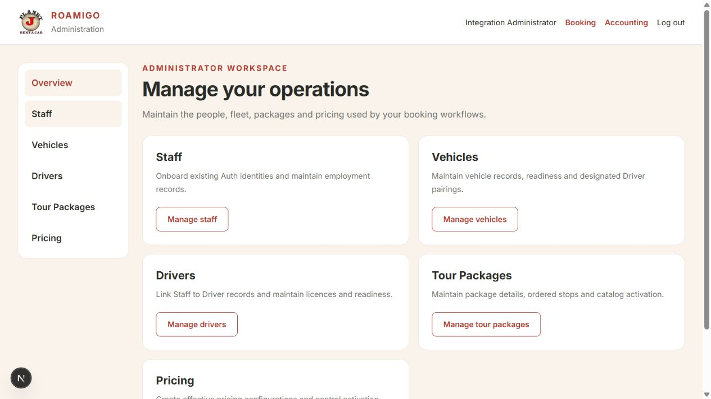
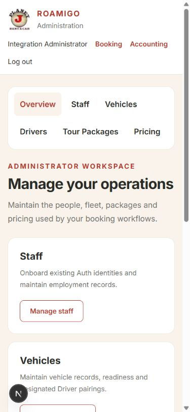

# Administration workspace

The minimal Admin panel is available at /admin. ADMIN login defaults to this
workspace; administrators can still open Booking and Accounting. STAFF,
CUSTOMER and DRIVER identities cannot enter Admin pages or its API proxy.
Driver linkage is resolved before checking the administrator role.

The panel uses live backend records and mutations for Staff, Vehicles, Drivers,
Tour Packages and Pricing. It includes create/edit forms, lifecycle controls,
vehicle pairing and ordered package stops. Staff onboarding requires an existing
Supabase Auth identity without an application profile; it does not create Auth
accounts or assign arbitrary roles. Vehicle type creation is not supported by
the backend. The vehicle type reference uses the existing customer catalog.

Backend readiness constraints, active work holds and pricing overlaps remain
authoritative. Destructive or operational lifecycle changes require explicit
confirmation in the form. An uncertain mutation disables resubmission until the
operator closes the form, refreshes records and checks the result.

The API proxy accepts only configured operations and fields. It verifies the
Admin session on every request, checks mutation origins, validates record IDs,
and passes the access token server-side to NestJS. It never accepts arbitrary
backend URLs. NestJS remains responsible for DTO and data-layer authorization.

The feature reuses Button, Input, Textarea, FormField, Card, Alert, EmptyState
and PageHeader with existing semantic tokens. No globally shared component API,
global token, component registry or showcase example was changed. AdminWorkspace
is feature-only composition.

## User-run verification

These commands are not run as part of implementation:

```bash
node --test tests/staff-access.test.mjs tests/auth-integration.test.mjs tests/admin-access.test.mjs
npm run lint
npm run build
```

Check Admin login and direct navigation, non-Admin API/page denials, server
unavailability and recovery, empty lists, pagination, form validation, keyboard
navigation and narrow-screen layouts. Use synthetic records in non-production
for mutations. Test Staff onboarding/edit/status, vehicle and Driver creation
and readiness/pairing, package creation/route replacement/activation, and pricing
activation conflicts. Do not treat source inspection as runtime verification.


## Live verification, November 19, 2026

The local frontend and backend were used with the approved non-production
Supabase project and synthetic records. Observed results:

- Synthetic Admin login opened /admin; Customer page access returned 404.
- All five resource lists returned HTTP 200 with real backend records.
- Staff, Driver, Vehicle, Package with two ordered stops, and inactive Pricing
  configuration creation succeeded through the browser forms.
- A pricing activation overlapping the existing configuration was rejected with
  the backend conflict message. Existing pricing was not changed.
- Anonymous API access returned 401; Customer and Driver API access returned 403.
- Foreign-origin mutations returned 403. Same-origin unknown commands,
  unexpected privilege fields and malformed record IDs returned 400.
- Desktop and 390-pixel mobile layouts were visually reviewed. The temporary
  viewport override was reset after inspection.

The native date form issue found during verification was fixed by capturing
named form controls before disabling them for submission. Date controls retain
native values without relying solely on controlled React state.

Edit, readiness, pairing, employment changes, deactivation, route replacement,
empty/unavailable states, multi-page navigation and uncertain Admin-save recovery
have not all been exercised live. Their source paths exist, but creation and
read checks do not prove every supported command. Regression tests, lint, type
checking and production build are not run for this Admin change.


## Final check results and remaining coverage

The user subsequently reported all 16 auth/staff/Admin tests passing, clean lint
and a successful production build. After the Accounting integration and deadline
fixes, the user also reported its 7/7 focused checks, clean lint and build.
These are executed-check results, separate from the remaining live lifecycle,
multi-page and Admin-save recovery gaps listed above.

Tracked by [frontend #21](https://github.com/duskysabs/ROAMIGO-frontend/issues/21).
This UI supports existing backend APIs; it does not complete all acceptance
criteria of [backend #22](https://github.com/duskysabs/ROAMIGO-backend/issues/22).



